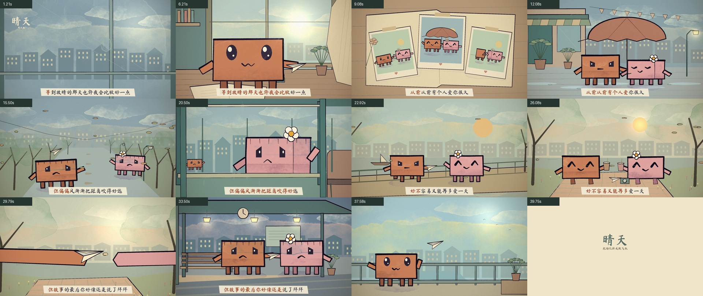

# Framecraft Skills

用 Codex 写代码，制作可编辑的水彩角色动画、歌词 MV 和动态排版短片。

本仓库由 [opus-video-skills](https://github.com/tuzhechen2005/opus-video-skills) 迁移而来，提供中文技能入口、Codex 元数据、项目初始化脚本与渲染检查流程。无需 Claude API，也不绑定某个模型。图像由代码绘制；歌曲由用户提供，`kinetic-reel` 另有程序合成配乐。

## 先看成片：《晴天》40 秒水彩 MV

[](https://github.com/jumpersun/framecraft-skills/releases/download/v1.0.0/qingtian-40s-v2.mp4)

**40 秒 · 1920×1080 · 24 fps · 13 个镜头**。上方是缩小、降帧后的无声 GIF，点击可下载带音频的 MP4。

[下载成片](https://github.com/jumpersun/framecraft-skills/releases/download/v1.0.0/qingtian-40s-v2.mp4) · [完整案例与复现](examples/qingtian/README.md) · [复制创作提示词](examples/qingtian/prompts.md) · [13 镜头分镜](examples/qingtian/STORYBOARD.md) · [验证记录](examples/qingtian/validation.md)

从等待放晴，到相册里的陪伴，再到风中分别、短暂重逢与挥手告别。画面随歌词推进，橙色男孩、粉色女孩和纸飞机贯穿全片。



## 两个技能怎么选

| Skill | 擅长的内容 | 技术与画面 |
| --- | --- | --- |
| [`painted-animation`](skills/painted-animation/SKILL.md) | 角色短片、叙事动画、歌词 MV | p5.js、p5.brush，水彩、纸张纹理、墨线、角色表演 |
| [`kinetic-reel`](skills/kinetic-reel/SKILL.md) | 产品介绍、技术成果、作品集、片头 | Canvas、three.js、动态大字、图形转场、程序配乐 |

《晴天》使用 `painted-animation`。两个技能都包含可运行模板、参考资料和检查工具；安装后可以让 Codex 自动选择，也可以在提示词里显式使用 `$painted-animation` 或 `$kinetic-reel`。

## 安装到 Codex

### 直接交给 Codex

把下面这段发给 Codex：

```text
使用 $skill-installer，从 https://github.com/jumpersun/framecraft-skills
安装 skills/painted-animation 和 skills/kinetic-reel。
若已有同名技能，先比较差异并保留现有修改。
```

技能安装完成后，在下一轮对话调用。如果只做角色动画，只安装 `painted-animation` 即可。

### 命令行安装

已安装 Codex 内置 `skill-installer` 时：

```bash
python3 "${CODEX_HOME:-$HOME/.codex}/skills/.system/skill-installer/scripts/install-skill-from-github.py" \
  --repo jumpersun/framecraft-skills \
  --path skills/painted-animation skills/kinetic-reel
```

该安装器使用 `$CODEX_HOME/skills`，默认 `~/.codex/skills`；目标已存在时会停止，避免覆盖。也可以从 [Release](https://github.com/jumpersun/framecraft-skills/releases/tag/v1.0.0) 下载技能 ZIP，解压后将两个技能目录放入个人 skills 目录。

## 制作前需要什么

| 依赖 | 用途 |
| --- | --- |
| Codex | 理解需求、设计分镜、编写与修改动画 |
| Node.js ≥ 22.12、npm | 执行渲染脚本、安装项目依赖 |
| Chrome / Chromium | 无头浏览器逐帧绘制；由 Puppeteer 驱动 |
| ffmpeg、ffprobe | 裁剪音频、编码 MP4、检查媒体 |
| Bash、rsync | 初始化作品项目 |
| Python 3、numpy（可选） | 使用 `beat_grid.py` 分析节拍 |

检查现有环境：

```bash
bash "${CODEX_HOME:-$HOME/.codex}/skills/painted-animation/scripts/new_project.sh" --check
```

Chrome 不在默认路径时设置 `CHROME_PATH`。npm 依赖安装在作品目录中，不放进技能模板。当前真实验证环境是 macOS Apple Silicon、Node 24.19.0、Chrome、ffmpeg 9.0.2；Linux 和 Windows 没有在本次发布中实机验证。Windows 还需要能运行 Bash/rsync 的环境。

## 一段提示词开始制作

```text
使用 $painted-animation，基于我提供的本地歌曲音频和歌词，制作约 40 秒水彩歌词 MV。

你来选择语义完整的片段，记录原曲起止时间；不要变速或改调。
画面要结合歌词讲故事，保留统一角色与贯穿道具，不能只是换背景配字幕。
先写 STORYBOARD.md，再直接制作；信息足够时无需反复确认细节。
同一段歌词可以用远景、人物近景、道具特写和不同视角展开。
加入适量前景运动、光线变化与自然转场，保证主体和歌词清晰。
逐镜头检查实际渲染结果，修复遮挡、接触、跳色和字幕问题。
交付 1080p MP4、分镜预览、字幕、可编辑源码，以及真实完成的验证记录。
```

这是通用启动提示词。包括音源、完整风格、镜头、人物动作、字幕、技术要求和迭代方式的《晴天》版本，见 [提示词全文](examples/qingtian/prompts.md)。换歌时重新选择片段和对齐歌词，不能直接套用本案例的时间码。

动态排版示例：

```text
使用 $kinetic-reel，把我提供的三个项目资料做成 45 秒中文作品集。
每个项目呈现一个具体问题、解决过程和有证据的成果。
用醒目的中文标题、图形运动和节拍配乐推进；数字只使用资料中的事实。
先写分镜，然后制作、检查字幕与转场，交付 MP4 和源码。
```

## 从需求到成片

| 阶段 | 要做的事 | 可检查的产物 |
| --- | --- | --- |
| 1. 输入 | 确认音频、歌词、时长、比例与参考素材 | 素材来源、原曲截取区间 |
| 2. 分镜 | 把歌词含义变成事件、动作和视角 | `STORYBOARD.md` |
| 3. 实现 | 角色、场景、字幕、镜头与时间轴 | 可编辑的代码与资产 |
| 4. 抽样 | 检查每镜头起段、中段、末段及关键动作连续帧 | 分镜图、连续帧图、局部特写 |
| 5. 渲染 | 并行逐帧绘制，记录缓存签名，合成音视频 | MP4 与渲染日志 |
| 6. 验证 | 检查时长、音视频轨道、完整解码与导出帧 | 成片检查说明 |

每帧由时间 `t` 决定，因此能抽取任意时刻、并行渲染和修正动作。画面输入变化会使缓存失效；缺帧时编码会停止。音频单独变化可以重新编码，但歌词节奏变化还需要修改画面。

## 《晴天》这次怎样变得更丰富

初版的八个镜头多次重复校园背景和双人正面构图。第二版保留音频与歌词时间，扩展为十三个镜头：

- **等待放晴**：雨滴特写 → 窗边独处 → 人物表情近景。
- **回忆陪伴**：俯拍相册 → 雨街共伞。
- **距离拉远**：风中长街 → 巴士离站 → 女孩的车窗视角。
- **再多一天**：桥上重逢 → 河边野餐 → 落日推进时间。
- **最后告别**：双手松开 → 暮色站台挥别 → 屋顶放飞纸飞机。

丰富度来自地点、景别、视角、动作和时间变化；人物与纸飞机保持连续。具体镜头时长、色彩和修复过程见 [案例](examples/qingtian/README.md)。

## 仓库结构

```text
skills/
  painted-animation/       Codex 水彩角色动画技能与模板
  kinetic-reel/            Codex 动态排版技能与模板
examples/qingtian/
  README.md                案例说明与复现步骤
  prompts.md               完整创作、细化和迭代提示词
  STORYBOARD.md            十三个镜头与歌词的对应关系
  validation.md            成片参数、检查结果与边界
  project/                 可编辑工程、布景、字体与歌词时码
docs/
  assets/                  README 的动图、封面和分镜图
  troubleshooting.md       常见问题与处理方法
  provenance.md            上游来源、迁移和模板修复记录
```

完整歌曲、依赖目录、逐帧缓存和工作日志不进入 Git。示例 MP4 与包含 40 秒音频的完整案例工程放在 Release；Git 中的案例工程可用自行准备的音频复现。

## 验证与已知边界

- 《晴天》成片经过完整解码、音视频参数检查、黑场/定格检测、关键帧和动作连续帧检查。
- 歌词时间来自本机音频模型的对齐估计；没有人工逐字听校。抽帧与完整解码不等于人工完整观看和试听。
- `beat_grid.py` 只分析节拍；通用字幕组件不自动识别歌词。案例保存了已经整理的行级与逐字时码。
- 通用模板仍使用网络字体；《晴天》案例改成了本地字体子集。换文案时需补齐字体字符。
- 模板默认横屏；竖屏需要重新排版和检查，不能只改分辨率。
- 抖音参考链接当时无法读取可播放视频；本案例的水彩视觉来自上游仓库示例与后续原创分镜。

[常见问题](docs/troubleshooting.md) · [本版验证记录](examples/qingtian/validation.md)
